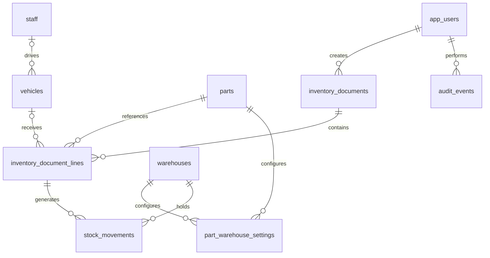

# Bước 1 — Thiết kế dữ liệu cho Tân Nam Chinh

Trạng thái: thiết kế và migration nền tảng đã chuẩn bị ở máy local; chưa kết nối giao diện, chưa tạo database Cloudflare, chưa chuyển dữ liệu thật. Bản ZIP gốc giữ nguyên.

Cập nhật sau bước 2: API danh mục, xác minh Cloudflare Access và phân quyền đã được triển khai/kiểm thử local; xem [tài liệu API](02-workers-api.md). Các quy tắc ghi sổ kho bên dưới vẫn thuộc bước tiếp theo, chưa có API ghi phiếu.

## Hướng triển khai

Giữ React/Vite hiện có. Dùng Cloudflare Workers để phục vụ giao diện và API; API truy cập Cloudflare D1. Trình duyệt không có quyền kết nối trực tiếp database. Xác thực sẽ được chọn và triển khai ở bước backend; `auth_subject` là định danh từ hệ thống xác thực, không phải mật khẩu. Chưa tạo tài khoản/mật khẩu mặc định.

Thứ tự làm việc:

1. Thiết kế và kiểm tra cấu trúc database lõi — bước hiện tại.
2. Dựng Workers/API, xác thực và quyền truy cập; thêm cơ chế ghi sổ nguyên tử, khóa kỳ, tính giá và kiểm thử tranh chấp.
3. Nối danh mục vật tư/kho/xe từ React với API trước; tiếp theo là phiếu nhập/xuất, tồn kho và báo cáo.
4. Bổ sung vòng đời lốp, lắp/tháo linh kiện, đề xuất/duyệt và phân hệ mở rộng bằng migration tiếp theo.
5. Đối soát dữ liệu cũ, nhập thử vào môi trường riêng, kiểm thử rồi triển khai Cloudflare.

## Những quyết định nền tảng

- Tồn kho được quản lý theo **vật tư + kho/bồn**. Không còn một currentStock duy nhất trên vật tư.
- Sổ biến động là nguồn tính tồn. Không cho sửa trực tiếp số tồn trong danh mục.
- Chứng từ có nháp, đã ghi sổ và hủy nháp. Chỉ phiếu đã ghi sổ ảnh hưởng tồn. Phiếu đã ghi sổ được sửa bằng chứng từ đảo/điều chỉnh có lý do, không xóa lịch sử.
- Số dư đầu là phiếu OPENING có ngày, số lượng, giá trị và người lập. Không tự nâng tồn lên 10.000/12.500 lít.
- Giá vốn dự kiến: bình quân liên hoàn theo từng vật tư/kho. Chốt giá vốn ở thời điểm ghi sổ, không lấy giá danh mục hiện tại để tính lại phiếu cũ. Thuật toán và xử lý chèn chứng từ quá khứ thuộc bước 2.
- Để bản đầu nhất quán, chưa cho ghi sổ lùi trước lần ghi sổ gần nhất của vật tư/kho; muốn thay đổi quá khứ cần quy trình mở kỳ và tính lại được kiểm soát. Quy tắc này sẽ thực thi tại API, chưa có trong migration.
- Ngày nghiệp vụ dùng YYYY-MM-DD theo giờ Việt Nam. Thời điểm tạo/duyệt/lịch sử dùng UTC. API phải kiểm tra ngày lịch hợp lệ, không chỉ hình dạng chuỗi.
- Số lượng lưu số nguyên theo hệ số 1.000: 1,250 lít → 1250; 2 quả → 2000. Mức chính xác tối đa ban đầu là 0,001 đơn vị. Vật tư đếm quả/cái cần thêm kiểm tra số nguyên đơn vị ở API.
- Đơn giá lưu số nguyên theo hệ số 1.000 VND; thành tiền và giá trị sổ lưu nguyên VND. API dùng phép tính chính xác và quy tắc làm tròn thống nhất; không dựa vào sai số số thực JavaScript. Các giá trị phải nằm trong giới hạn số nguyên an toàn của JavaScript.
- UUID do API sinh. Mã phiếu hiển thị duy nhất; không dùng hậu tố ngẫu nhiên ba chữ số. Idempotency key và request hash giúp nhận diện gửi lại cùng yêu cầu và từ chối cùng key nhưng khác nội dung.
- Danh mục đã được tham chiếu chỉ ngừng sử dụng (`is_active`/status), không xóa cứng. Foreign key dùng RESTRICT.
- Không coi vai trò ghi trong database là đã có phân quyền: API phải xác minh danh tính và kiểm tra quyền mỗi thao tác.

## Cấu trúc 12 bảng lõi

| Bảng | Mục đích |
|---|---|
| app_users | Danh tính tài khoản và vai trò ứng dụng; không lưu mật khẩu thô. |
| staff | Nhân sự/tài xế, tách khỏi tài khoản đăng nhập. |
| warehouses | Kho/bồn, mã duy nhất, loại, vị trí và sức chứa tùy chọn. Sức chứa tính theo đơn vị cơ sở của kho; bồn dầu dùng lít. |
| suppliers | Nhà cung cấp. |
| vehicles | Phương tiện, biển số duy nhất, tài xế phụ trách, ODO, trạng thái. |
| parts | Vật tư, SKU duy nhất, đơn vị, nhóm, định mức và đánh dấu quản lý serial. |
| part_warehouse_settings | Vị trí kệ và mức tồn tối thiểu của từng vật tư tại từng kho. |
| accounting_periods | Khóa theo tháng toàn hệ thống và thông tin người khóa. |
| inventory_documents | Đầu phiếu, loại, ngày, trạng thái, người lập/ghi sổ, đối tác, chống nhập trùng. |
| inventory_document_lines | Chi tiết vật tư, kho nguồn/đích, xe, ODO, tài xế và thông tin chụp tại thời điểm lập. |
| stock_movements | Biến động số lượng và giá trị theo dòng phiếu và kho. |
| audit_events | Lịch sử thao tác, trước/sau, người thực hiện, lý do và request. |

View `current_stock` tổng hợp số lượng và giá trị từ biến động của phiếu đã ghi sổ. Vật tư/kho chưa có biến động sẽ không có hàng trong view; API danh mục phải LEFT JOIN và COALESCE về 0. Giá bình quân hiển thị được suy ra từ giá trị/số lượng còn lại, không phải trường giá nhập tay trong danh mục.

Quan hệ chính:

## Quy tắc ghi sổ cần thực thi ở bước 2

1. API xác minh tài khoản, quyền và dữ liệu; nhóm các dòng trùng vật tư/kho trước khi kiểm tra tồn.
2. Kiểm tra kỳ mở, ngày hợp lệ, mã duy nhất, idempotency và trạng thái danh mục. Không lấy người lập từ dữ liệu người dùng gửi lên.
3. Tính giá và biến động: IN/OPENING cộng kho đích; OUT/SCRAP trừ kho nguồn; TRANSFER có hai vế bằng nhau về số lượng và giá trị; RECOVERY phải có giá trị thu hồi được xác định; ADJUSTMENT có phê duyệt và lý do. RETREAD là vòng đời lốp và chi phí, không mặc định coi là xuất kho.
4. Ghi đầu phiếu, chi tiết, biến động và audit trong **một batch nguyên tử**. Khóa kỳ và kiểm tra tồn tại thời điểm ghi phải có bảo vệ ngay trong SQL/điều kiện ghi hoặc trigger; không chỉ SELECT trước rồi ghi sau.
5. Nếu bất kỳ kiểm tra nào thất bại, toàn bộ batch phải thất bại. Cần kiểm thử hai người cùng xuất khi tổng yêu cầu vượt tồn. UPDATE không khớp hàng chưa chắc tạo lỗi SQL, nên không được coi zero changes tự động rollback batch.
6. Phiếu đã ghi sổ bất biến; đảo phiếu tạo phiếu mới với biến động ngược. Chỉ đảo một lần và phải kiểm tra đảo có làm âm tồn hoặc vi phạm kỳ khóa không.
7. Mọi cập nhật trạng thái/ODO phải có audit. ODO không tự giảm; sửa sai ODO cần quyền, lý do và lịch sử riêng.

Migration bước 1 **chưa thực thi** các quy tắc tổng hợp/cross-table nói trên. Nó có khóa ngoại, ràng buộc số dương, mã duy nhất và cấu trúc liên kết; không đủ để đưa API ghi kho vào production. Chưa có tài khoản Cloudflare hoặc ID database được điền giả.

## Báo cáo đúng theo kỳ

- Tồn đầu: tổng biến động đã ghi sổ có ngày nghiệp vụ < ngày bắt đầu.
- Nhập/xuất trong kỳ: theo biến động và loại chứng từ, có phân biệt điều chuyển nội bộ khi tổng hợp toàn công ty để không tính hai lần.
- Tồn cuối: tổng biến động có ngày <= ngày kết thúc.
- Giá trị tồn: cộng giá trị sổ theo cùng mốc ngày; không nhân tồn quá khứ với giá vốn hiện tại.
- Báo cáo cấp dầu chỉ tính phiếu xuất phù hợp; phiếu nhập dầu không cộng vào số cấp. Bồn nguồn là warehouse_id; mục đích cấp là fuel_target; không suy ra từ regex trong diễn giải.

## Ánh xạ từ source hiện tại

| Hiện tại | Database mới |
|---|---|
| SparePart | parts + part_warehouse_settings |
| currentStock/avgCostPrice | Sổ stock_movements và view current_stock; không chuyển thành số dư mặc định. |
| Vehicle | vehicles; assignedDriver được ánh xạ sang staff.id. |
| InventoryTransaction | inventory_documents; không tin totalAmount từ client, tổng từ chi tiết. |
| TransactionItem | inventory_document_lines + stock_movements khi ghi sổ; bắt buộc gắn vehicle_id nếu cấp cho xe. |
| Danh mục kho/NCC/nhân sự localStorage | warehouses/suppliers/staff sau chuẩn hóa. |
| AccountingPeriodLock | accounting_periods + audit_events; số chốt có thể bổ sung snapshot ở migration tiếp. |
| MountedComponent, TireDetail | Thiết kế ở migration tiếp: serialized_assets, component_installations, asset_events, odometer_readings. Chưa nhập vào bảng lõi này. |
| MaterialRequisition | Migration riêng cho đề xuất, chi tiết và phê duyệt; không giả làm phiếu xuất. |

Không tự nhập seed đang có: chênh 12.500/669 lít, biển số MP-15H-061.51 và các ODO thấp cần được đối soát. File nguồn đóng sẵn và localStorage thực tế của người dùng là hai nguồn khác nhau; chưa có bản xuất localStorage thực tế trong workspace.

## Phạm vi kiểm tra local

Chạy `node scripts/check-database-schema.mjs` từ thư mục source-review. Script dùng SQLite trong bộ nhớ của Node, không kết nối mạng, không tạo database thật và không sửa dữ liệu ứng dụng. Kiểm tra tạo migration trên database rỗng, các khóa ngoại/mã duy nhất/số lượng, liên kết biến động, view chỉ tính phiếu đã ghi sổ và bảo vệ xóa tham chiếu. Đây là kiểm chứng SQLite local, chưa xác nhận trên runtime D1/Wrangler.

## Tài liệu nền tảng

- [Cloudflare Workers Static Assets](https://developers.cloudflare.com/workers/static-assets/)
- [D1 migrations](https://developers.cloudflare.com/d1/reference/migrations/)
- [D1 foreign keys](https://developers.cloudflare.com/d1/sql-api/foreign-keys/)
- [D1 database API và batch](https://developers.cloudflare.com/d1/worker-api/d1-database/)
